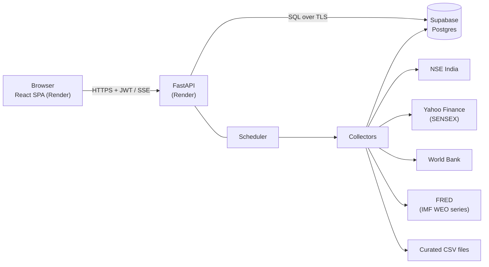

# Economic Indicators Dashboard

A full-stack dashboard that shows a live market ticker and six macro-economic indicator panels for India.
React single-page app, FastAPI backend, Supabase (Postgres) database.

| | |
|---|---|
| **Live app** | `https://economic-indicator-frontend.onrender.com`  |
| **API docs (Swagger)** | `https://economic-indicator-ifil.onrender.com/docs` |
| **Evaluation viewport** | 1214 × 2159 CSS pixels |

---

## Contents

1. [Features](#features)
2. [Architecture](#architecture)
3. [Tech stack](#tech-stack)
4. [Project structure](#project-structure)
5. [Data sources](#data-sources)
6. [Getting started](#getting-started)
7. [Configuration](#configuration)
8. [Database and migrations](#database-and-migrations)
9. [API](#api)
10. [Testing](#testing)
11. [Deployment](#deployment)
12. [Security](#security)
13. [Error handling and resilience](#error-handling-and-resilience)
14. [Design notes](#design-notes)
15. [Troubleshooting](#troubleshooting)
16. [Known limitations](#known-limitations)

---

## Features

- **Live market ticker** with NIFTY BANK, NIFTY IT and SENSEX, pushed to the browser over Server-Sent Events, with polling as a fallback.
- **Six indicator panels:** GDP growth (India vs World), Debt to GDP, Imports / Exports / Trade balance, GST collection, Inflation, Government expenditure.
- **Honest data handling:** values that a source does not publish are shown as `---`. Nothing is estimated or filled in.
- **Per-panel status:** *ok*, *stale* (last refresh failed, last valid data kept) and *unavailable*, plus source name, link and "as of" date on every panel.
- **Interactive charts:** legend items toggle series, tooltips on hover, ticker pauses on hover.
- **Fit-to-screen toggle:** switch between the normal responsive layout and the full 1214 × 2159 canvas scaled to your window.
- **JWT authentication** with rate-limited login. Accounts are created by an administrator; there is no public sign-up.
- **Interactive API documentation** (Swagger UI) with typed responses and documented error codes.

## Architecture



- The browser talks **only** to the FastAPI backend, never to NSE or any other upstream, and never to the database.
- Collectors run inside the API process on a schedule. Each upstream response is validated, only valid numbers are written, and every run is logged in `collector_runs`.
- If a refresh fails, the last valid data stays in place and the API marks it **stale** instead of showing wrong or empty numbers.
- Backend layering: `api/routes` (HTTP) → `services` (payload building) → `repositories` (parameterised SQL) → `db/pool`.

## Tech stack

| Layer | Technology |
|---|---|
| Frontend | React 18, TypeScript, Vite, Recharts, lucide-react |
| Backend | Python 3.11+, FastAPI, psycopg 3 (async pool), APScheduler, httpx, PyJWT, passlib (bcrypt) |
| Database | Supabase Postgres with SQL migrations |
| Hosting | Render (frontend), Render (backend), Supabase (database) |
| Tests | pytest, pytest-asyncio, Vitest |

## Project structure

```
.
├── backend/
│   ├── app/
│   │   ├── api/              # routes (auth, dashboard, health), dependencies, rate limiter
│   │   ├── collectors/       # ticker, worldbank, fred, curated (+ shared base, scheduler)
│   │   ├── core/             # settings, errors, logging, security, event-loop helper
│   │   ├── db/               # connection pool, migration runner
│   │   ├── repositories/     # SQL access (users, indicators, ticker, runs)
│   │   ├── schemas/          # Pydantic request/response models
│   │   ├── services/         # dashboard payload builder, ticker event bus
│   │   └── main.py
│   ├── data/curated/         # CSV datasets for indicators with no public API
│   ├── migrations/           # ordered SQL files (+ optional/ least-privilege role)
│   ├── scripts/              # create_user
│   ├── tests/
│   ├── run.py                # recommended local entry point (works on Windows)
│   └── Dockerfile
├── frontend/
│   └── src/
│       ├── api/              # typed API client
│       ├── auth/             # login page and auth context
│       ├── components/       # Dashboard, Panel, StatCard, Ticker, charts
│       ├── hooks/            # data loading, SSE ticker, fit-to-screen
│       ├── styles/
│       ├── utils/
│       └── test/
└── docs/                     # Supabase setup, API reference, deployment, assumptions
```

## Data sources

| Panel | Source | Notes |
|---|---|---|
| Ticker: NIFTY BANK, NIFTY IT | NSE India `allIndices` endpoint | Cookie-primed session. Refreshed every 60 s in market hours. |
| Ticker: SENSEX | Yahoo Finance public chart endpoint | SENSEX is a BSE index, so it is labelled **non-NSE** in the UI. |
| GDP growth, India vs World | World Bank `NY.GDP.MKTP.KD.ZG` | Annual. |
| Debt to GDP, India and US | IMF World Economic Outlook, general government gross debt, via FRED (`GGGDTAINA188N`, `GGGDTAUSA188N`) | The IMF's own API blocks automated requests, and the World Bank has no recent India values for this measure. FRED lags by one to two years. |
| Exports / Imports | World Bank `NE.EXP.GNFS.CD`, `NE.IMP.GNFS.CD` | Goods and services, current US$. Trade balance = exports − imports. |
| GST collection | Finance Ministry / PIB figures, `data/curated/gst_collections.csv` | No public API. Monthly average = annual total ÷ 12. |
| Inflation | World Bank `FP.CPI.TOTL.ZG` | RBI target is a configured constant (default 4%). |
| Government expenditure | Union Budget documents, `data/curated/union_budget_expenditure.csv` | Only years that were verified are included. Others show `---`. |

Curated figures carry a `basis` (`actual`, `estimate`, `revised_estimate`), and the UI marks non-actual values. Add only numbers you can cite.

## Getting started

### Prerequisites

- Python 3.11 or newer
- Node.js 20 or newer
- A Supabase project (see [Database and migrations](#database-and-migrations))

### 1. Backend

```bash
cd backend
python -m venv .venv

# Windows (PowerShell)
.venv\Scripts\activate
# macOS / Linux
source .venv/bin/activate

pip install -r requirements-dev.txt
cp .env.example .env            # then fill in DATABASE_URL and JWT_SECRET
python -m app.db.migrate        # create the schema (safe to re-run)
python -m scripts.create_user --email you@example.com --role admin
python run.py                   # http://127.0.0.1:8000  (Swagger at /docs)
```

> **Windows:** always start the API with `python run.py`. It switches Python to the event loop that psycopg's async mode needs. Starting `uvicorn` directly fails with a `ProactorEventLoop` error.

### 2. Frontend

```bash
cd frontend
cp .env.example .env            # VITE_API_BASE_URL=http://localhost:8000
npm install
npm run dev                     # http://localhost:5173
```

Sign in with the account created above. Collectors run at startup, so panels fill in within a few seconds.

## Configuration

### Backend (`backend/.env`)

| Variable | Default | Purpose |
|---|---|---|
| `DATABASE_URL` | – | Supabase Postgres URI (session pooler), with `?sslmode=require` |
| `JWT_SECRET` | – | Signing key, at least 32 characters |
| `JWT_ALGORITHM` | `HS256` | Token algorithm |
| `ACCESS_TOKEN_MINUTES` | `60` | Token lifetime |
| `CORS_ORIGINS` | `http://localhost:5173` | Exact frontend origin(s), comma separated. `*` is rejected at startup. |
| `APP_ENV` | `development` | `production` in deployment |
| `ENABLE_API_DOCS` | `true` | Serve Swagger at `/docs` |
| `COLLECTORS_ENABLED` | `true` | Run the background collectors |
| `NSE_REFRESH_SECONDS` | `60` | Ticker interval in market hours (Mon–Fri 09:00–16:00 IST) |
| `NSE_OFF_HOURS_REFRESH_SECONDS` | `900` | Ticker interval outside market hours |
| `MACRO_REFRESH_HOURS` | `6` | World Bank / FRED / curated refresh interval |
| `HTTP_TIMEOUT_SECONDS`, `HTTP_MAX_RETRIES` | `10`, `2` | Upstream timeout and retries |
| `RBI_INFLATION_TARGET` | `4.0` | Value shown on the Inflation panel |
| `DB_POOL_MIN`, `DB_POOL_MAX` | `1`, `5` | Connection pool size |

Generate a secret with `python -c "import secrets; print(secrets.token_urlsafe(48))"`.

### Frontend (`frontend/.env`)

| Variable | Purpose |
|---|---|
| `VITE_API_BASE_URL` | Base URL of the API, with no trailing slash. Read **at build time**, so changing it requires a rebuild or redeploy. |

Never put secrets in `VITE_*` variables. They are embedded in the public bundle.

## Database and migrations

1. Create a project at [supabase.com](https://supabase.com).
2. Open **Connect**, copy the **Session pooler** connection string, append `?sslmode=require`, and put it in `DATABASE_URL`.
3. Apply the migrations:

```bash
python -m app.db.migrate            # apply pending migrations
python -m app.db.migrate --status   # show applied / pending
```

| Migration | Purpose |
|---|---|
| `20261015000001_init_schema.sql` | Tables, indexes, row-level security on, `anon` / `authenticated` privileges revoked |
| `20261015000002_seed_indicators.sql` | Indicator catalogue (names, sources, staleness windows) |
| `20261016000003_debt_source_fred.sql` | Points the Debt to GDP panel at the FRED series |
| `optional/least_privilege_role.sql` | Run manually: a limited `dashboard_backend` role for production |

Migrations are idempotent and checksummed. **Never edit a migration after it has been applied.** Add a new file with the next number instead; the runner refuses to continue if an applied file has changed.

**Data footprint:** `ticker_quotes` holds 3 rows that are overwritten on each refresh, and macro observations are upserted, so neither grows. `collector_runs` gets one row per collector run and is pruned after 30 days. Full details are in `docs/SUPABASE_SETUP.md`.

## API

Interactive documentation: `/docs` (raw spec at `/openapi.json`). To try a protected endpoint, call `POST /api/v1/auth/login`, copy `access_token`, click **Authorize**, and paste it.

| Method | Path | Auth | Description |
|---|---|---|---|
| GET | `/health` | no | Liveness |
| GET | `/health/ready` | no | Database check and latest result of each collector |
| POST | `/api/v1/auth/login` | no | Exchange e-mail and password for a JWT |
| GET | `/api/v1/auth/me` | yes | Current user |
| GET | `/api/v1/dashboard` | yes | Ticker and all six panels |
| GET | `/api/v1/ticker` | yes | Ticker only |
| GET | `/api/v1/stream/ticker` | yes | Server-Sent Events stream of ticker updates |

All errors use one envelope: `{"error": {"code", "message", "request_id"}}`. Missing values are `null` in responses. See `docs/API.md` for the full payload.

## Testing

```bash
cd backend && pytest      # parsers, security, payload logic, and API integration tests
cd frontend && npm test   # formatting utilities
```

The backend integration tests write a test user and the curated datasets to the database named in `DATABASE_URL`. **Point them at a separate, migrated test database**, not production.

## Deployment

The reference setup is Supabase (database), Render (API) and Render (frontend). The detailed walkthrough is in `docs/DEPLOYMENT.md`; the outline is:

1. **Database.** Run migrations and create the first user from your own machine *before* restricting network access. Run `optional/least_privilege_role.sql` and use that role in the production `DATABASE_URL`. Turn off Supabase's Data API.
2. **API on Render.** New Web Service, root directory `backend`, runtime Docker, health check path `/health`, **one instance** (the scheduler and event bus run in-process). Set `DATABASE_URL`, `JWT_SECRET`, `APP_ENV=production` and `CORS_ORIGINS`.
3. **Frontend on Render.** Root directory `frontend`, build command `npm run build`, output `dist`, environment variable `VITE_API_BASE_URL=https://<your-api>.onrender.com`. Redeploy after changing it.
4. **Link them.** Set `CORS_ORIGINS` on Render to the exact Render origin (no trailing slash).
5. **Restrict the database.** In Supabase, open **Project Settings → Database → Network Restrictions** and allow only the Render outbound ranges (Render service → **Connect** → **Outbound**) plus your own IP, as separate IPv4 entries. Restrictions apply to direct connections and the pooler.
6. **Verify.** `GET /health/ready` shows the database up, then sign in on the live site.

## Security

- Passwords are hashed with bcrypt; login compares in constant time and returns one generic failure message.
- Login is limited to 5 attempts per minute per address and e-mail.
- JWT access tokens (HS256, 60 minutes by default) are sent in the `Authorization` header. The SPA keeps the token in `sessionStorage`, so it is cleared when the tab closes.
- CORS allows only the configured origins and only the methods and headers the app uses.
- All SQL uses bound parameters.
- Row-level security is enabled on every table with no public policies, and `anon` / `authenticated` privileges are revoked. The browser has no route to the database.
- Secrets live only in environment variables. `.env` files are git-ignored.
- Responses carry `X-Content-Type-Options`, `Referrer-Policy` and `Cache-Control: no-store`.

## Error handling and resilience

- **API:** typed error envelope with a request ID on every failure. Unhandled exceptions return a generic 500 and are logged with a stack trace, never exposed to the client.
- **Collectors:** timeouts, bounded retries, strict response validation, and per-series isolation, so one failing source does not block the others. Failures are recorded in `collector_runs` and never overwrite good data.
- **Frontend:** loading skeletons, per-panel *unavailable* and *stale* states, a banner when a background refresh fails (the last good data stays visible), a full-page retry when nothing has ever loaded, and automatic sign-out when a token expires.
- **Ticker:** reconnects with exponential backoff and falls back to polling.

## Design notes

- The layout targets the **1214 × 2159** evaluation viewport and is capped at 1214 px wide.
- Where the reference image is consistent, the app favours correct data: arrows and colours follow the sign of the change, the GST panel's legend names its real series, fiscal years are labelled `FY25`, and the Debt chart uses yearly points because its sources are annual.


## Troubleshooting

| Symptom | Cause and fix |
|---|---|
| `Psycopg cannot use the 'ProactorEventLoop'` (Windows) | Start the API with `python run.py`, and put the event-loop helper at the top of any script that uses the database. |
| `ModuleNotFoundError: pydantic_settings` | The virtual environment is missing or not active. Activate it and run `pip install -r requirements.txt`. |
| `ERROR: ... was modified after being applied` | An applied migration was edited. Revert it and add a new migration. |
| Deployed site calls `localhost:8000` | `VITE_API_BASE_URL` was not set when the frontend was built. Set it in Render and redeploy. |
| Browser console shows a CORS error | `CORS_ORIGINS` on the API does not exactly match the frontend origin (scheme, host, no trailing slash). |
| FRED collector fails with `ReadError` or a timeout | FRED stalls requests that do not use a curl-style `User-Agent`. The collector sets one explicitly. |
| IMF returns `403 Forbidden` | The IMF blocks scripted requests, which is why the debt series comes from FRED. |
| A panel shows "Data currently unavailable" | The collector has not stored valid data yet. Check `collector_runs` or the API log for the error. |
| Database connection refused or times out after enabling restrictions | Your current IP or Render's outbound ranges are not on the allow list. |
| First request after idle takes about a minute | Free hosting plans put the API to sleep when idle. |
| `another command is already in progress` warning in the log | Harmless. A request was cancelled mid-query when a page was refreshed; the pool replaces the connection. |

## Known limitations

- NSE and Yahoo Finance endpoints are unofficial. They can change format or block cloud addresses, in which case the ticker shows *stale* or *unavailable* rather than wrong values.
- Collectors and the ticker event bus run inside one API process. Running several instances would need a shared bus (Postgres `LISTEN/NOTIFY` or Redis) and a single scheduler.
- Render's default outbound IP ranges are shared with other customers in the same region, so the Supabase allow list narrows access but is not exclusive to this service. A dedicated outbound IP gives exclusivity.
- Supabase's free plan pauses projects after a period of inactivity. Restore the project before demos.
- Debt data lags by one to two years (FRED), and some Union Budget years are missing until verified figures are added to the CSV.
- There are no refresh tokens: users sign in again when the access token expires.


## Links :
* frontend : https://economic-indicator-frontend.onrender.com/
* api_documentation_url : https://economic-indicator-ifil.onrender.com/docs
* api_health-check_url : https://economic-indicator-ifil.onrender.com/health/ready
* panel credentials 
username : panel@example.com
password : 1234567890
* portfolio link : https://praveena292.github.io/praveena2092.github.io/
